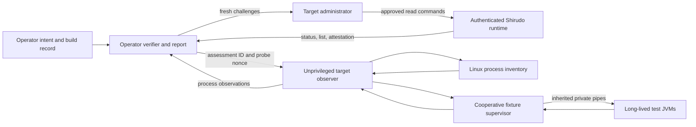

# Kintsugi architecture

**Proposed MVP.** One Linux target, a declared set of long-lived HotSpot processes and one upstream Java shield, `java-sql-inj`. An unprivileged, non-web Spring Boot command orchestrates one assessment. A Linux operator outside the target verifies Shirudo evidence and assembles the final report. The target administrator handles upstream lifecycle operations, and service owners control JVM starts. The same Java distribution can run in observation and reporting roles. No resident network service is required. See [upstream contracts](UPSTREAM-ANALYSIS.md), [technical decisions](FEASIBILITY.md) and [trust boundaries](THREAT-MODEL.md).

## Deployment and data flow

The transfer arrows can be an operator-driven file exchange over existing administrative transport. During the MVP, a target administrator invokes fixed read-only runtime commands for a verifier-issued nonce and returns their outputs. This avoids granting the JVM observer root or arbitrary command execution. The verifier runs the trusted operator CLI itself; importing a target-authored “verified” Boolean would move the verification inside the adversary's boundary. A missing verifier round trip still permits a local inventory report, clearly marked as lacking fresh verified host evidence.

## Build and module boundaries

Choose **Java 21 LTS**, with one pinned, maintained x86-64 HotSpot distribution/build for both the observer and target fixtures. It supports JEP 451 policy testing, the upstream SQL shield's Java 11 bytecode and a current Boot line. Choose a pinned Spring Boot 4.2.x release compatible with Java 21, Maven Wrapper 3.9.x and Maven Toolchains. Choose concrete supported patch versions and record checksums at milestone 0. Java 25 LTS is a later compatibility lane and a candidate for the upstream release-24 Base64 example. A Java 17 target or an alternate JVM requires its own qualification; the observer runtime does not determine target compatibility. Maven fits the existing SQL example and supports independent test forks. Keep Shirudo's own Make/C, signing and VM builds intact. [Spring Boot requirements](https://docs.spring.io/spring-boot/system-requirements.html) · [JDK support roadmap](https://www.oracle.com/java/technologies/java-se-support-roadmap.html) · [Failsafe toolchains](https://maven.apache.org/surefire/maven-failsafe-plugin/examples/toolchains.html) · [SQL build pin](https://github.com/shirudo-dev/shirudo/blob/39923c519f601c687a6c95aff40a3733172d5673/upatches/java-sql-inj/pom.xml)

| Proposed module | Responsibilities and allowed dependencies |
|---|---|
| `assurance-core` | Pure Java records for intent, process lifetime, evidence provenance, observation intervals, verdicts and reasons. Deterministic reducer with explicit missing/conflict branches. No Spring, shell, Attach API or transformer dependency. |
| `shirudo-cli` | Operator-side adapter for the real prediction and verification executables, plus versioned readers for existing target outputs. Maps documented schema, verdict, exit code and explicit verification profile to typed observations. Holds no signing keys. Preserves original evidence and the exact arguments used. Depends on core. |
| `linux-jvm` | Read-only process discovery and bounded metadata collection. Optional, explicitly enabled same-user `jcmd` adapter for startup clues; passive discovery works with attach disabled. Depends on core. |
| `orchestrator` | Spring Boot command-line lifecycle, configuration, scheduling of a single run, deadlines, file import/export and error reporting. Wires the adapters and core in the requested role. No web server or embedded agent. |
| `assurance-fixtures` | Test scope only. Long-lived cooperative H2 application and local supervisor; an operator-supplied, signed upstream shield is an external test input. Exercises JDBC from the same loader and process under observation. No fixture endpoint in arbitrary JVMs. |

These are build/module boundaries within one project. Data flows from adapters into the pure reducer. Platform-specific code remains behind adapters so Windows can run report and contract tests. Keep all Spring dependencies out of fixtures and instrumentation; the SQL agent retains its own upstream build and classpath.

## Identity and operator intent

An **intent record** comes from the operator, outside the target's report. It pins the deployment, declared service/unit and expected count, allowed UID, JDK distribution/build, namespace scope, shield name, expected signed payload digest, raw JAR digest from the same build, and the reviewed probe profile. Fixture build and H2 versions are additional inputs. A process name or an arbitrary application-supplied label never makes a JVM an intended target. Conflicting selectors produce an ambiguous match. An intentional control is marked exempt; a negative-control JVM selected as *required* should produce a coverage finding.

Identify a local process lifetime by observer-scoped host/boot ID, PID namespace inode, PID and kernel start ticks (field 22 of `/proc/<pid>/stat`). Also record real/effective UID as available, process executable device/inode, unit/cgroup and mount namespace for scope checks. A boot ID is a **local correlation hint**. The AK name and the verifier's trusted enrollment identify the attested target. Never treat a string supplied by a Java process as either identity. Re-read identity around a diagnostic or probe; a mismatch, exec to another image, disappearance or ambiguous supervised child invalidates that observation. A PID plus start time alone is inadequate for a future mutation. [Linux procfs](https://docs.kernel.org/filesystems/proc.html) · [Process stat layout](https://man7.org/linux/man-pages/man5/proc_pid_stat.5.html) · [Upstream boot-ID limitations](https://github.com/shirudo-dev/shirudo/blob/39923c519f601c687a6c95aff40a3733172d5673/Documentation/security/threat-model.rst#L446)

Enumerate numeric entries from the observer's procfs mount. Classify launcher-executable matches as candidates; a mapped `libjvm` helps recognize embedded/renamed launchers when maps are readable. Record how each was identified. Corroborate candidates against the supervisor or expected service membership. `hidepid`, short-lived processes and namespace isolation can hide whole processes. Report expected-but-unresolved slots and scan limitations even when enumeration appears empty. For an unconstrained, invisible population the count is unknown. Never infer a protection percentage without a known denominator.

## Assessment protocol

1. **Open a run.** The verifier creates a run ID, fresh random nonces, local deadlines and the approved host profile. The operator predicts the register from the independent boot inventory and planned event history. Input includes all enrolled certs, tree/config/boot references as applicable, and the policy for this lab. Keep fixture-state expectations separate from host-state expectations.
2. **Bracket the observation.** Collect and independently verify a first host attestation and associate contemporaneous `upatch list --json` and `status --json` snapshots. Capture process observations. Collect a second verification with a different nonce after the probe window. For an “unchanged host interval” require the same enrolled target, TPM epoch, expected register and policy at both ends. If a host transition or reboot intervenes, keep the records and repeat in a fresh window. Local timestamps or two matching list rows cannot establish this interval.
3. **Observe startup.** A trusted fixture supervisor records child PID, intended executable, launcher context and effective agent option at launch. For a separately owned JVM, optional fixed-command diagnostics may expose the JVM's own view. Record only whether the exact expected sealed-path option is present, its source and observation time. Do not persist raw environment or full VM arguments. Missing `/proc/cmdline` flags are common when options came from the environment. A current JAR digest cannot establish which bytes a pre-existing process loaded.
4. **Observe effect.** For the fixture only, the supervisor directly launches each JVM as a distinct long-lived child and retains its private stdin/stdout channels. A request consists of a fresh nonce and one predefined probe identifier. The child performs the two fixed H2 operations, returns the nonce and normalized outcomes. The supervisor binds the reply to its still-live child handle and the OS lifetime before and after; give each request a timeout and reject duplicates or replies from another run. Use a clean diagnostic channel separate from logs. This demonstrates behavior in that target even though the target can lie. A probe executed in a newly launched helper must be credited only to that helper. See [discriminator and assumptions](FEASIBILITY.md).
5. **Reduce and retain.** Emit one row per intended service instance, extra visible JVMs separately, and any missing/ambiguous slots. Retain source digests and an operator-side run manifest, upstream CLI/build IDs, evidence capture intervals and verification inputs. Keep restricted original host evidence separately from the redacted report. Write the completed report atomically; a crash leaves an incomplete run that can never inherit a past positive. Fresh runs may reuse parsed immutable artifacts but never nonces or live observations.

## Report semantics

Proposed dimensions are independent. Preserve status/list and upstream verification errors alongside the facts; avoid a single boolean “protected.”

| Dimension | Example values | Rule |
|---|---|---|
| Intent / scope | required, exempt, ambiguous, unresolved | Expected workloads drive the denominator. |
| Host verification | expected state verified, mismatched, unverified, changed during observation | Include the expected state (present or retired), payload, epoch, profile and provenance. “Installed” from local inventory alone is reported separately. |
| Launch observation | expected option observed, observed configuration omits option, unavailable | May describe stale or placeholder paths. Never sufficient to promote runtime effect. |
| Behavior | guard response observed, baseline response observed, inconclusive, unsupported | Require passing benign control, discriminating result, fresh challenge and stable target identity for either observed outcome. |
| Conclusion | behavior corroborated for this interval, coverage gap, residual effect after retirement, contradictory evidence, unknown | No row asserts TPM-attested bytecode or continuous protection. Retain evidence from each dimension even when the host fails verification. |

**Decision examples.** With a verified present payload and a healthy cooperative JVM returning the baseline scalar, emit “coverage gap” for that workload. With the same host evidence and a restricted process, emit “unknown” and the permission reason. An expected option plus baseline effect is a gap with a configuration/behavior discrepancy. A fresh positive effect after verified retirement is a residual effect; if the workload should now be clear, report a retirement discrepancy. If a behavior is observed with untrusted host identity, preserve it as a local observation without attributing it to the signed deployment. An unknown schema, nonce reuse, ambiguous workload, unexpected additional agent or unsupported target build prevents a positive attribution. Even the best outcome remains scoped to one tested invocation path.

## Operational limits

Use explicit absolute executable paths and argument arrays, a minimal environment, bounded stdin/stdout/stderr and timeouts. Store probe and evidence inputs privately, reject symlinks/unexpected owners on imports as appropriate, and never execute paths reported by a target JVM. The privileged upstream commands stay operator-run. Place upper bounds on scan time and parallelism; report skipped work with a reason. No remote debug ports, arbitrary SQL, scripts, shell commands, expression evaluation or active attach remediation are part of this contract. The service owner may separately restart an approved workload. On a newer upstream build or schema, preserve the raw report, mark compatibility unqualified and qualify against fresh fixtures before accepting a verdict.
